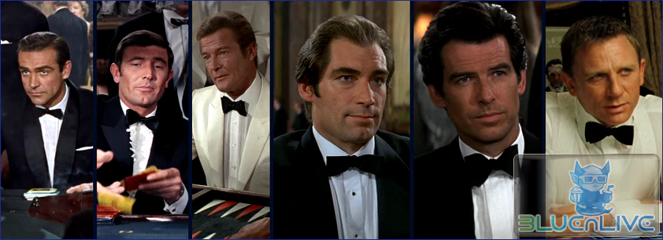
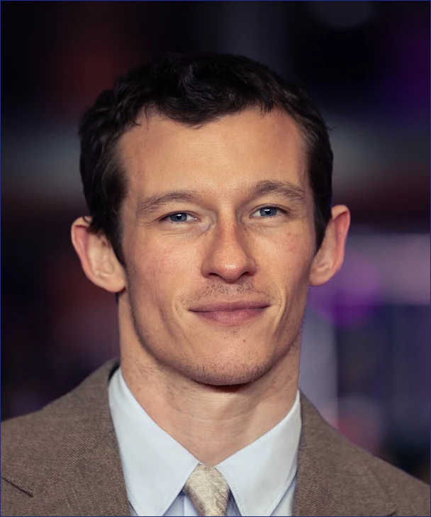
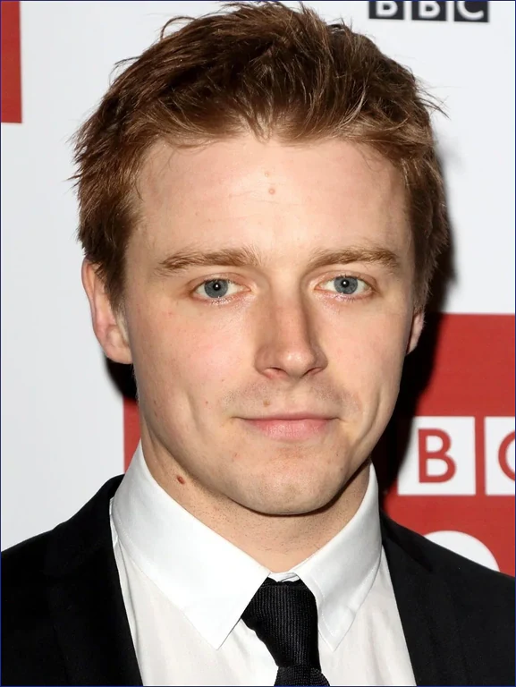
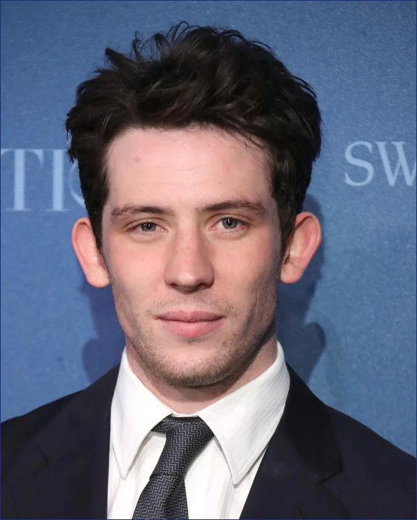

*도박판의 제왕(들)*

## 브로콜리 남매의 제작권 이양과 차기 제임스 본드 유력 후보 3인

60년 넘게 이어져 온 007 시리즈가 거대한 분기점을 맞았다.\
기존 시리즈는 전권을 브로콜리 집안의 EON 프로덕션이 갖고 있었다.\
이를 EON의 바버라 브로콜리와 마이클 G. 윌슨 남매가 아마존 MGM 스튜디오에 창작 통제권을 넘긴 것이다.[^1]

가업 형태로 철저히 관리되던 프랜차이즈가 **할리우드 빅테크**의 품으로 들어간 셈이다.\
이로 인해 26번째 제임스 본드 영화의 Tone & Manner는 짙은 안갯속에 빠졌다.

기존에도 배우 교체 시에는 스타일을 계속 바꾸긴 했지만, 그것 역시 알 수 없는 상황이다.

{: .bluebox-blue}
- **션 코너리**: 우아한 야수
- **조지 래젠비**: 비극을 겪는 인간
- **로저 무어**: 유쾌한 귀족 신사
- **티모시 달튼**: 시대를 앞서간 냉혈 요원
- **피어스 브로스넌**: 하이브리드 완성형
- **다니엘 크레이그**: 상처 입고 피 흘리는 야수

이런 흐름이 있었지만, 다음 본드는 어떤 스타일로 가져갈지 스튜디오의 셈법이 복잡하다.\
EON에서 계속 제작을 했다면 브로스넌이나 무어 시절의 경쾌한 첩보물로 돌아갈 가능성이 높았을 것이다.\
하지만, 아마존이 그럴 **배짱**이 있을까…

### 기존 유력 후보들이 밀려난 현실적 배경

제작 주체의 변화는 캐스팅 판도마저 크게 뒤흔들었다.

{: .bluebox-gray}
- **에런 테일러존슨(Aaron Taylor-Johnson):**\
브로콜리 체제에서 가장 유력한 내정자로 꼽혔으나, 아마존이 제작 전면에 나서며 우선순위에서 밀려남
- **헨리 카빌, 톰 하디, 이드리스 엘바:**\
오랜 기간 팬들의 지지를 받았음\
하지만 40대 중후반에 접어든 나이로 인해, 향후 10~15년을 끌고 갈 장기 계약 조건에서 자연스럽게 제외
- **로버트 패틴슨 & 니콜라스 홀트:**\
연기력은 검증됐음\
하지만 각각 DC 유니버스의 《더 배트맨》과 《슈퍼맨(렉스 루터 역)》이라는 대형 프랜차이즈에 묶여 있어 합류가 어려움

결국 제작진은 30대 중반의 나이, 장신 체격 조건, 탄탄한 연기력을 갖춘 영국 배우들을 중심으로 최종 압축에 들어갔다.

---

## 최종 스크린 테스트에 오른 유력 3인의 스펙

할리우드 유력 매체인 [TheWrap](https://www.thewrap.com/creative-content/movies/final-james-bond-screen-tests-jack-lowden-callum-turner-josh-oconnor/)과 [IGN](https://www.ign.com/articles/final-james-bond-screen-tests-are-underway-with-jack-lowden-callum-turner-and-others-on-the-shortlist)에 따르면, 아마존 MGM 스튜디오는 최근 최종 후보군을 대상으로 액션 스턴트와 대사 소화력을 검증하는 스크린 테스트를 진행했다.

외신이 취재를 통해 공식 확인한 핵심 3인의 프로필은 다음과 같다.

### 1. 칼럼 터너 (Callum Turner)

- **기본 프로필:**\
영국 런던 해머스미스 출신. 1990년생. 약 187cm, 78~80kg.
- **피지컬 특징:**\
모델 출신다운 긴 비율과 날렵한 체형[^2]\
185cm가 넘는 장신이라 턱시도 실루엣과 고전적인 영국 신사 이미지에 잘 부합함
- **주요 보도 내용:**
  - **[NME 단독 보도: James Bond experts think Callum Turner has been named new 007](https://www.nme.com/news/film/james-bond-experts-think-callum-turner-has-been-named-new-007-3974783):** 영국 버크셔 브레이 스튜디오(Bray Studios)에서 최종 카메라 및 액션 스크린 테스트를 마친 사실이 집중 조명됐음
  - **[Kalshi 예측 마켓: James Bond casting odds: Jack Lowden, Callum Turner neck and neck](https://news.kalshi.com/p/james-bond-casting-market-lowden-leads-turner):** 글로벌 예측 시장에서 잭 로던과 1·2위를 다투며 가장 강력한 선두 주자로 평가받고 있음
  - **피어스 브로스넌의 지지:** 5대 본드인 피어스 브로스넌이 공개 인터뷰를 통해 "터너는 훌륭한 본드가 될 것"이라며 호의적인 지지를 보냈음

### 2. 잭 로던 (Jack Lowden)

*《덩케르크》의 스핏파이어 파일럿 콜린스 소위*

- **기본 프로필:**\
영국 에식스 첼름스퍼드 출생(스코틀랜드 국경지대 성장). 1990년생. 약 185cm, 80kg 안팎.
- **피지컬 특징:**\
탄탄한 상체 프레임과 다부진 체격\
다니엘 크레이그처럼 거친 맨몸 육탄전을 소화하는 '현장 요원' 느낌을 가장 잘 살림
- **주요 보도 내용:**
  - **[Variety 인터뷰: Jack Lowden Plays Coy About James Bond Rumours](https://au.variety.com/2026/film/news/jack-lowden-responds-james-bond-rumours-42193/):** 드라마 《슬로 호시스》에서 호흡을 맞춘 대선배 게리 올드만이 "제작진이 이미 선택을 마쳤을 것"이라며 로던을 공개 지지했고, 로던 본인 역시 인터뷰를 통해 "매우 영광스럽고 기분 좋은 일(all very flattering)"이라며 입장을 밝혔음
  - **원작 설정 부합:** 이언 플레밍 원작상 제임스 본드의 아버지가 스코틀랜드인이라는 점에서, 로던의 스코틀랜드 정체성은 정통 본드 팬덤의 두터운 지지를 얻고 있음

### 3. 조시 오코너 (Josh O'Connor)

*《나이브스 아웃꞉ 웨이크 업 데드 맨》에서 제임스 본드와 연기 합을 맞춘 적 있음*

- **기본 프로필:**\
영국 햄프셔 사우샘프턴 출생(첼트넘 성장). 1990년생. 약 185cm, 74~76kg.
- **피지컬 특징:**\
슬림하고 날렵한 체형에 뚜렷한 이목구비. 지적이고 차분하면서도 내면에 서늘한 긴장감을 품은 스파이 이미지.
- **주요 보도 내용:**
  - **[World of Reel 보도: Jack Lowden, Callum Turner and Josh O'Connor Will Screen-Test for James Bond This Week](https://www.worldofreel.com/blog/2026/10/22/jack-lowden-callum-turner-and-josh-oconnor-will-screen-test-for-james-bond-this-week):** 데드라인과 버라이어티 내부 소식통을 인용해 조시 오코너가 최종 테스트 제안을 받은 핵심 3인에 확실히 포함됐음을 전했음
  - **BBC 공식 인터뷰:** 오코너는 BBC와의 인터뷰를 통해 본드 하마평에 오른 것에 대해 "믿기지 않는 영광"이라며 소문 자체를 숨기지 않고 긍정적으로 언급했음. 드라마 《더 크라운》과 영화 《챌린저스》로 입증된 연기 스펙트럼이 강점.

---

## 새 시대 007의 향방

세 배우는 모두 **1990년생(30대 중반)**, **185cm 이상의 신장**, 그리고 **영국 정통 연기파**라는 공통점이 있다.

신체 조건과 나이, 연기력이라는 기본 전제는 모두 채워졌다.\
이제 남은 것은 아마존 MGM 스튜디오가 지향하는 새로운 톤 앤 매너다.\
클래식한 신사, 거친 실전 요원, 지적이고 입체적인 스파이 중 누구의 손에 발터 PPK가 쥐어질 것인가.

[^1]: 2022년 아마존의 MGM 인수에 이어, 2025년 2월 브로콜리 남매가 크리에이티브 전권을 공식 이양했음
[^2]: 이거 어째 조지 래잰비의 향기가…
