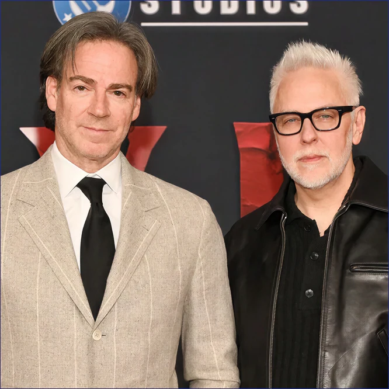
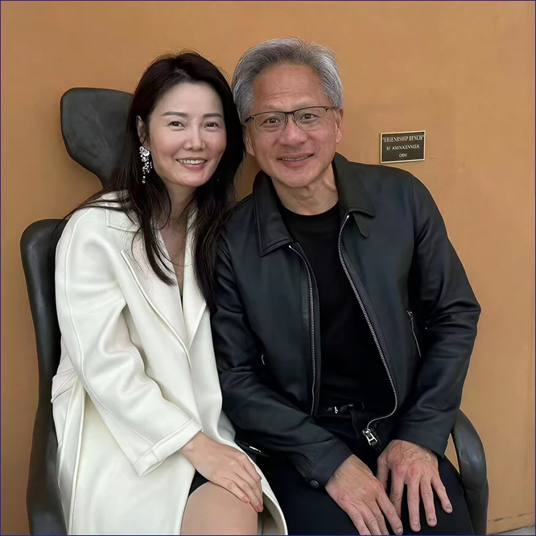

007 시리즈의 고전 《**나를 사랑한 스파이(The Spy Who Loved Me)**》.\
그리고 이를 노골적으로 패러디했던 《**오스틴 파워: 나를 따먹은 스파이(The Spy Who Shagged Me)**》.

오늘 들려온 두 거물의 소식을 보며 이 기막힌 제목들이 스쳐 지나갔다.\
DC 스튜디오 수장에서 물러난 제임스 건.\
그리고 치명적인 스파이 스캔들에 휘말린 엔비디아의 젠슨 황이다.

---

## 1. 오늘 전해진 두 개의 대형 사건

{: .bluebox-red}
* **제임스 건의 퇴임**:\
[제임스 건과 피터 사프란이 12월 1일부로 DC 스튜디오 공동 CEO에서 물러난다](https://www.cbc.ca/news/entertainment/skydance-james-gunn-peter-safran-9.7415294).\
4년 만의 하차다. 후임은 **마블** 출신의 제레미 래첨이 맡는다.\
건은 경영을 내려놓고 일개 연출·제작자로 돌아간다고 발표했다.
* **젠슨 황의 스캔들**:\
[젠슨 황이 중국 스파이 의혹을 받는 여성과의 불륜을 공식 인정하고 사과했다](https://www.yna.co.kr/view/AKR20261109160151072).\
FBI 조사와 이사회 조사, 주주 소송까지 번지며 엔비디아 주가가 급락했다.\
세계 최고 테크 권력자의 치명적인 보안 참사다.\
**AI 때문에 보안이 붕괴된다**는 말이 많았지만, 이건 아니잖아…

---

## 2. 제임스 건: "D.C.를 사랑한 스파이"

*The Spies Who Loved D.C.*

제임스 건은 늘 입버릇처럼 **"DC 코믹스를 진심으로 사랑한다"**고 말했다.\
하지만 그가 지난 4년간 남긴 족적을 돌아보면 뭔가 뒷목이 서늘해진다.

마블의 핵심 감독이 경쟁사의 최고 권좌에 올랐다.\
그리고 가장 먼저 한 일은 **DC의 대들보를 뽑아내는 것**이었다.

{: .bluebox-red}
* **헨리 카빌**의 복귀를 발표 몇 주 만에 뒤엎고 **내쫓았다**.
* 세계관 리셋을 선언해 개봉 대기 중이던 잔여작들을 연쇄 침몰시켰다.
* DC 고유의 웅장함을 지우고 본인 취향의 **B급 캐릭터**와 지인들을 채웠다.
* 그래놓고 정작 본인은 유니버스의 **운전대를 4년 만에 던져버렸다**.

스튜디오 프랜차이즈에서 쇼러너 완장을 뗀 감독은 흔한 **고용직**에 불과하다.\
전임자의 흔적을 그렇게 지워댔던 그를 새 수장이 챙겨줄 리도 만무하다.\
겉으로는 사랑을 외치며 들어와 안쪽에서부터 적진을 초토화한 자.\
그야말로 완벽하게 임무를 끝낸 《D.C.를 사랑한 스파이》다[^1].

---

## 3. 젠슨 황: 말 그대로 당해버린 "나를 따먹은 스파이"

*The Spy Who Shagged Huang*

제임스 건이 **사랑을 위장**해 적진을 턴 스파이라면, 젠슨 황은 정반대다.\
문자 그대로 《나를 따먹은 스파이》의 **희생양**이 되었다.

기업 경영의 거친 방식이나 카리스마의 문제가 아니다.\
냉혹한 비즈니스 감각으로 세계 최고 자리에 오른 인물이다.\
그런 그가 **고전적인 미인계** 하나에 허망하게 무너졌다.

{: .bluebox-red}
* **사적인 불륜 관계**에 빠져들었다.
* 그 대가로 상대가 **스파이**라는 사실조차 모른 채 **얽혀버렸다**.
* 완벽해 보이던 빅테크 제국이 **침실 작전** 앞에서 맥없이 뚫린 것이다.

이건 거창한 산업 스파이 스릴러도 아니다.\
007을 패러디했던 《오스틴 파워》의 **B급 코미디 영화 제목 그대로**다.\
**사냥꾼인 스파이**에게 홀려 육체도, 명예도, 회사의 보안 신뢰도 털려버린 현실판 참극이다.

---

## 4. 두 스파이가 남긴 씁쓸한 코미디

한쪽은 적진을 사랑한다며 들어가 **기둥을 다 뽑아놓고 손을 털었다**.\
다른 한쪽은 낯선 스파이에게 홀려 **제국의 틈을 내어주고 말았다**.

하나는 엔터테인먼트 판을 뒤흔든 트로이 목마였고,\
하나는 테크 제국을 뒤흔든 치명적인 허니트랩이었다.

스크린 속 첩보물보다 더 영화 같은 현실이다.\
두 편의 스파이 영화 제목이 오늘처럼 적나라하게 와닿는 날도 드물다.



[^1]: 그런데, 후임자도 또 마블 출신이라는 게…
