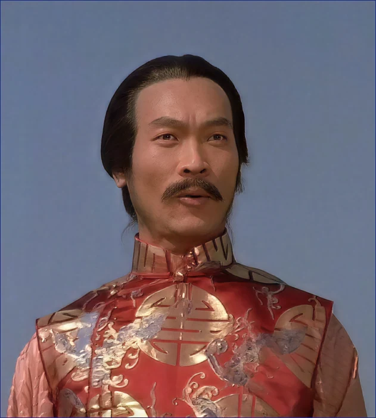
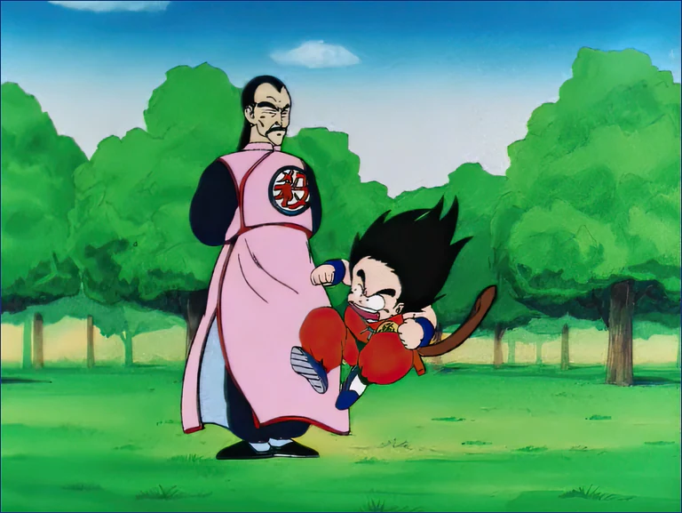

1970년대는 한류는 커녕 대한민국이란 나라의 존재 조차 잘 알려지지 않았던 시절이었다.\
이 때 홍콩 무술 영화에서 악역으로 이름을 떨친 분이 **황정리 선생님**이었다.

*고 황정리 선생님, 1944년 12월 21일 ~ 2026년 11월 12일 (향년 81세)*

그를 대스타로 만든 영화 〈취권〉에서 그가 맡았던 악역의 이름이 무려 염왕신각(閻王伸脚)[^1]이었다.\
물론, 이 이름에 걸맞는 **현란한 발기술**을 CGI 같은 게 아니라 그냥 **피지컬**로 해내셨다[…]

심지어 이 때 **성룡을 발탁한 게 황정리 선생님**이란 얘기가 있는데, 거짓은 아닌 것 같다.



한 양덕이 그 분의 영상들을 모아 유튜브에 올리기도 했다.



이후 토리야마 아키라의 《드래곤볼》에서 **타오 파이파이**의 모델이 되었다는 **설**이 있다.\
이젠 작가님도 황정리 선생님도 모두 고인이 되어 확인할 길은 없겠지만…

*황정리 선생님에서 모티브를 따온 캐릭터가 아닐 수 없는 타오 파이파이*



[^1]: 대략 해석하면 '염라대왕의 귀신같은 발'
