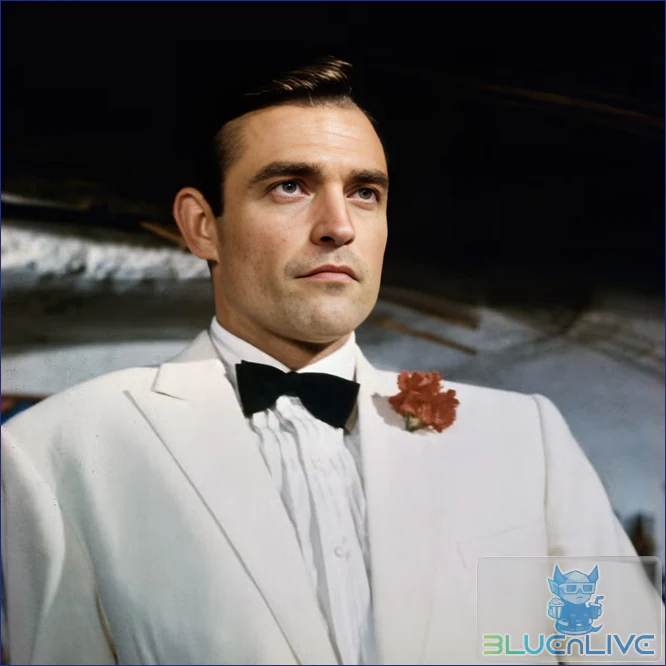
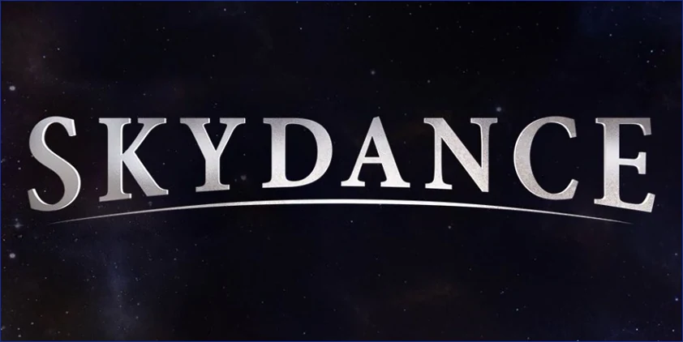
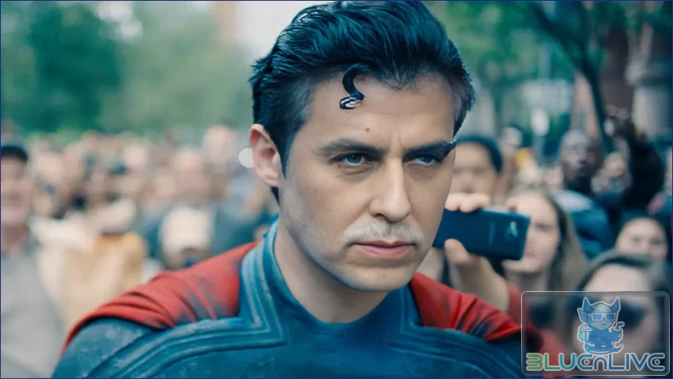

## Robert Pattinson is James Bond

2026년 11월 16일, 아마존 MGM 스튜디오가 제7대 제임스 본드로 **로버트 패틴슨**을 공식 발표했다.\
연출은 드니 빌뇌브 감독이 맡는다.



화려한 이름값 뒤로 씁쓸한 뒷맛이 남는다.\
배우 개인의 연기력이나 호불호와는 별개의 문제다.

*아는 분들은 다 아는 그 사진일까?*

이번 선발 과정은 60년 이어온 007 캐스팅의 전통과 절차적 공정성을 정면으로 거슬렀다.

### 1. 혼란에 빠진 할리우드 지형, 그리고 두 영웅의 기묘한 동거

최근 할리우드 최대 이슈는 래리 엘리슨[^1]의 자본을 등에 업은 스카이댄스의 워너브라더스 디스커버리(WBD) 인수였다.

*집안 돈으로 넷플릭스의 위약금까지 대납한 그곳*

넷플릭스 **위약금**까지 대납하며 워너를 삼킨 스카이댄스는 곧바로 **DC 스튜디오 수장 제임스 건과 피터 사프란을 해임**했다.

*DC 내에서 트롤링 하다가 깡통을 얻어맞은 그 분...*

모기업의 주인이 바뀌고 수뇌부가 날아가면서 DC 유니버스는 거대한 혼란에 빠졌다.\
하지만 패틴슨은 《더 배트맨 파트 2》에서 하차하지 않았다.\
오히려 배트맨 촬영을 이어가면서 동시에 경쟁 스튜디오인 아마존 MGM의 제임스 본드 역까지 거머쥐었다.\
한 배우가 현역 **배트맨**과 **007**을 동시에 연기하는 초유의 사태가 벌어진 셈이다.

### 2. 공개 테스트는 연막이었나: 들러리가 된 30대 후보들

더 큰 문제는 아마존 MGM이 보여준 불투명한 선발 과정이다.\
지난 몇 달간 외신과 베팅 시장은 칼럼 터너, 잭 로던, 조시 오코너 등 1990년생 영국 배우들의 치열한 경쟁으로 달아올랐다.\
[글로벌 예측 시장의 배당률 경쟁](https://news.kalshi.com/p/james-bond-casting-market-lowden-leads-turner)부터 [NME의 터너 유력 보도](https://www.nme.com/news/film/james-bond-experts-think-callum-turner-has-been-named-new-007-3974783), [버라이어티의 잭 로던 인터뷰](https://au.variety.com/2026/film/news/jack-lowden-responds-james-bond-rumours-42193/)까지 분위기를 끌어올렸다.

**10월 말에는 영국 브레이 스튜디오에서 이들이 최종 스크린 테스트**를 치른다는 소식까지 전해졌다.\
[TheWrap 단독 보도](https://www.thewrap.com/creative-content/movies/final-james-bond-screen-tests-jack-lowden-callum-turner-josh-oconnor/)와 [IGN 숏리스트 검증 기사](https://www.ign.com/articles/final-james-bond-screen-tests-are-underway-with-jack-lowden-callum-turner-and-others-on-the-shortlist), [World of Reel 테스트 일정 보도](https://www.worldofreel.com/blog/2026/10/22/jack-lowden-callum-turner-and-josh-oconnor-will-screen-test-for-james-bond-this-week)가 잇따르며 기대감은 최고조에 달했다.

하지만 결과는 이미 다른 대형 프랜차이즈를 이끄는 톱스타의 낙점이었다.\
정식 절차처럼 포장됐던 30대 배우들의 검증 과정은 결과적으로 대중의 시선을 돌리는 **연막**이자 **들러리 쇼**에 그쳤다.

### 3. 공정한 발굴 대신 작동한 '제작진 인맥'과 자본 논리

패틴슨이 배트맨이라는 거대한 제약에도 본드 역을 따낸 배경에는 두터운 **제작진 인맥**이 자리한다.\
연출을 맡은 드니 빌뇌브 감독은 이미 《듄: 파트 3》에서 패틴슨과 호흡을 맞추며 깊은 신뢰를 쌓았다.\
이번 007의 프로듀서 데이비드 헤이먼은 2005년 《해리 포터와 불의 잔》에서 무명이던 패틴슨을 처음 발굴한 장본인이다.

여기에 MGM 인수와 브로콜리 남매의 창작 전권 확보에 천문학적 자금을 쏟아부은 아마존의 조급함이 맞물렸다.\
신예 발굴이라는 모험 대신, 감독·프로듀서 사단과 검증된 톱스타의 티켓 파워에 기댄 손쉬운 선택이었다.

### 4. EON 프로덕션의 불문율을 지운 편의주의

과거 EON 프로덕션 체제에서 007 캐스팅에는 엄격한 불문율이 존재했다.\
다른 캐릭터의 얼굴로 각인된 배우를 배제하고, 오직 **본드로만 10년 이상 활약**할 배우를 찾아내는 원칙이었다.\
션 코너리부터 다니엘 크레이그까지, 본드는 언제나 새로운 발견을 통해 시리즈의 생명력을 이어왔다.

그러나, 아마존 MGM은 첫 작품부터 그 전통을 지워버렸다.\
거대 자본의 리스크 회피와 제작진 내부의 인맥 중심 캐스팅이 60년 프랜차이즈의 고유한 품격을 훼손했다.

---

## 맺음말

로버트 패틴슨은 뛰어난 역량을 지닌 매력적인 배우다.\
하지만 그가 본드가 되는 과정에는 신선한 발견의 카타르시스도, 공정한 경쟁의 설득력도 없었다.

패틴슨은 배트맨의 망토 위에 007의 턱시도를 겹쳐 입게 되었다.\
할리우드 거대 자본이 프랜차이즈의 정체성보다 단기 흥행 보증 수표와 인맥을 우선시한다는 걸 보여준 씁쓸한 선례로 남을 것 같다.

[^1]: 바로 그 오라클 창업자임
