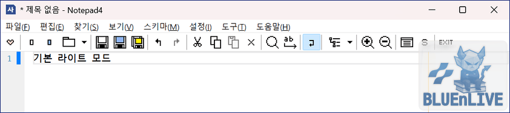
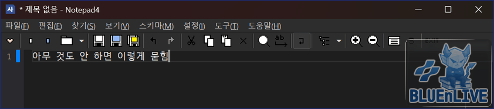
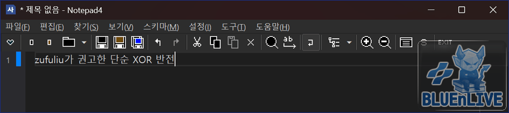
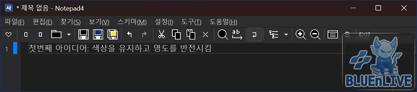
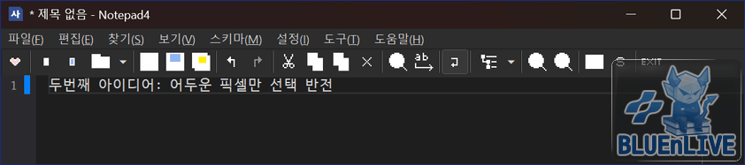
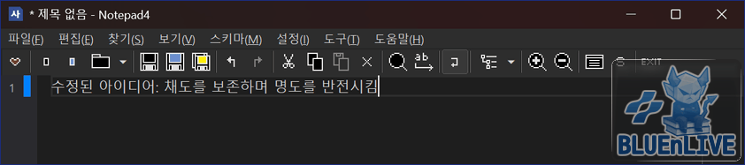
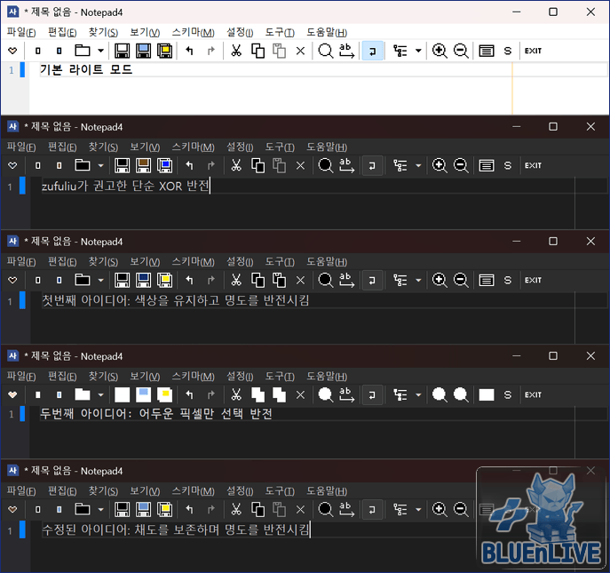

## 1. Notepad4의 기본 입장은 단일 툴바 이미지 세트 유지


*목표는 이 툴바 이미지 한 세트만 사용하는 것*

최근 Notepad4 메인 브랜치에 다크 모드가 정식으로 반영되었다.\
그러면서 어두운 배경에 기존 툴바 아이콘이 파묻히는(?) 문제가 수면 위로 올라왔다.


*아이콘이 어두운 배경에 파묻힌 결과*

라이트/다크용 이미지를 따로 두거나 SVG로 교체하자는 의견도 나왔다.\
하지만 개발자 Zufuliu의 입장은 명확하다.\
실행 파일 크기를 줄이기 위해 **하나의 툴바 이미지 세트로 라이트 모드와 다크 모드를 모두 처리**하는 것이다.

---

## 2. Zufuliu의 제안

Zufuliu는 [GitHub 이슈(#1287)](https://github.com/zufuliu/notepad4/issues/1287)에서 나를 언급하며 본인이 시도해 본 런타임 변환 코드를 공유해 주었다.\
다크 모드가 활성화된 경우, 툴바 비트맵을 불러온 직후 메모리에서 RGB 값을 `0x00ffffff`로 XOR 반전시키는 방식이다.

```cpp
void BitmapInvertColor(HBITMAP hbmp) noexcept {
    BITMAP bmp;
    if (GetObject(hbmp, sizeof(BITMAP), &bmp) && bmp.bmBitsPixel == 32) {
        const ULONG count = bmp.bmHeight * bmp.bmWidth;
        uint32_t *prgba = static_cast<uint32_t *>(bmp.bmBits);
        for (ULONG x = 0; x < count; x++, prgba++) {
            *prgba ^= 0x00ffffff;
        }
    }
}
```

본인이 테스트한 결과에선 썩 만족스럽지 않았다고 한다.\
하지만, 내 커스텀 툴바에 활용할 수 있다면 AVX2/SSE2 구현까지 포함해 `Helpers.cpp`에 추가해 주겠다고 제안했다.\
내 툴바 이미지는 **단색에 가까워** 적용하기에 훨씬 유리한 상황이기 때문이었다.

---

## 3. 세 가지 변환 방식 테스트

내가 쓰는 커스텀 툴바는 **어두운 외곽선**과 **단색 아이콘**이 많아 다크 모드에 적합하지 않다.\
따라서 손을 봐야 했는데, Zufuliu가 마침 제안을 한 상황이었다.

`CreateBars()`에서 툴바 이미지 리스트를 만들기 직전에 세 가지 방식을 차례로 적용해 비교했다.

1. **Zufuliu 방식 (단순 RGB XOR 반전)**

{: .bluebox-blue}
* 구현은 가장 간단하다.
* 하지만 보색 반전이 일어나 유채색 아이콘의 색상이 엉뚱하게 뒤집힌다. 결과물이 다소 거칠다.


*비트맵 반전의 결과꞉ 너무 공격적인 색상 반전*

2. **A안 (명도 반전 + 색상 유지)**

{: .bluebox-blue}
* 각 픽셀의 `max`와 `min`을 구해 색상(Hue)은 유지하고 명도만 뒤집는다.
* 외곽선은 깔끔하게 살아난다. 다만 핑크색 하트 같은 밝은 파스텔톤 아이콘이 검붉게 변하는 어색함이 남는다.

```cpp
const int maxC = max(max(r, g), b);
const int minC = min(min(r, g), b);
const int delta = 255 - (maxC + minC);
// 각 채널에 delta를 더해 명도만 반전
r = clamp(r + delta, 0, 255);
g = clamp(g + delta, 0, 255);
b = clamp(b + delta, 0, 255);
```


*외곽선은 살아남았지만, 아이콘의 색이 어색해짐*

3. **B안 (어두운 픽셀만 선택 반전)**

{: .bluebox-blue}
* 휘도가 절반 미만인 어두운 픽셀만 반전시키고 밝은 면은 그대로 둔다.
* 유채색은 유지되지만 전체적인 대비가 지나치게 공격적으로 보인다.

```cpp
// ITU-R BT.601 휘도(Luminance) 기준 어두운 픽셀만 선택 반전
const int luma = (r * 299 + g * 587 + b * 114) / 1000;
if (luma < 128) {
    r = 255 - r;
    g = 255 - g;
    b = 255 - b;
}
```


*너무 공격적인 결과*

---

## 4. 최종 결정: 채도 보존 명도 반전

결국 가장 자연스러웠던 **A안을 기반으로 두 가지를 튜닝**하는 방향으로 확정했다.

{: .bluebox-blue}
* **채도(Chroma) 가중치 적용:**\
`max - min`으로 채도를 계산해, 채도가 높은 유채색일수록 반전 폭을 줄여 원래 색감을 유지
* **눈부심 방지:**\
순수 검정이 순수 흰색(`255`)으로 뒤집히면 다크 모드에서 너무 밝음\
목표 밝기를 약 88%(`225/255`)로 낮춰 차분한 은회색 톤으로 맞춤

```cpp
const int maxC = max(max(r, g), b);
const int minC = min(min(r, g), b);
const int effectiveChroma = (maxC - minC) * 2;
if (effectiveChroma < 255) {
    const int delta = ((225 - (maxC + minC)) * (255 - effectiveChroma)) / 255;
    r = clamp(r + delta, 0, 255);
    g = clamp(g + delta, 0, 255);
    b = clamp(b + delta, 0, 255);
}
```


*최종 선택*

---

덧. 구현된 툴바 이미지들을 한 자리에서 비교하면 다음과 같음.


