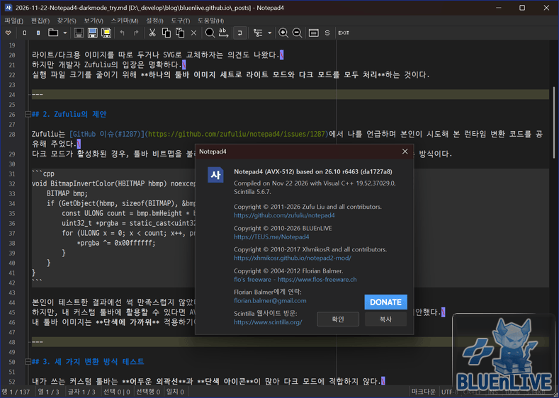

오류를 수정하고 다양한 성능 개선이 반영된 버전을 공개한다.\
26.10에서의 가장 큰 변화는 **다크 모드**를 정식으로 지원하는 것이다.

## 개요

아래 링크에서 다운받을 수 있으며, 언제나 그렇듯 x86/x64/AVX2/AVX-512/ARM64 버전이 함께 들어있다.



## 히스토리

{: .bluebox-history}
* 2026.11.22꞉ 26.10 r6463 공개
  * **Release v26.10r6392.** 적용 ([링크](https://github.com/zufuliu/notepad4/commit/46405bb897272c797a852656432ec003babb265f))
  * [WebAssembly] Update keyword to October 2026 ([링크](https://github.com/zufuliu/notepad4/commit/b5a5108259cdb9206b4fb2db01ccf4c438ab066c))
  * [WebAssembly] Highlight annotation and symbolic identifier with different color. ([링크](https://github.com/zufuliu/notepad4/commit/495b835a3c622146f12aac761c1ed2b2963b2cb7))
  * Update Python API to Python 3.15 ([링크](https://github.com/zufuliu/notepad4/commit/046570920ce9067ef581473601dc20abe4fa5567))
  * Implement CSS highlighting for HTML and SVG ([링크](https://github.com/zufuliu/notepad4/commit/89b8b36e0ee2c23f73be922315f17261ccfbbe1a))
  * Don't ask save current file when open Recent Files or Favorites dialog. ([링크](https://github.com/zufuliu/notepad4/commit/ba4f4212fc2205511e2c3922a4538b64ec3cf92d))
  * Lazy load recent files MRU list. ([링크](https://github.com/zufuliu/notepad4/commit/7045b62d90bd47e4ebd2d99db48b326b7ed521e2))
  * Update CSS property list to October 2026. ([링크](https://github.com/zufuliu/notepad4/commit/7b5e542186bff1c0269791fa9c5d1f3b901b21b6))
  * [HTML, XML] Highlight unquoted number (SCE_H_NUMBER) same as Value. ([링크](https://github.com/zufuliu/notepad4/commit/7657534501076142784d58f0b8080f4d04752c17))
  * [HTML] Support JavaScript Unicode escape identifier \uHHHH. ([링크](https://github.com/zufuliu/notepad4/commit/3abe7b41bd37f0096541716d387254778f97d458))
  * [HTML, XML] Highlight unquoted number as value. ([링크](https://github.com/zufuliu/notepad4/commit/93ac1729a192b618f61d1f4e1fc0a3ae7e770160))
  * [HTML, PHP] Set nested state mask (used for backtracking) when CSS block ended with non-zero states. ([링크](https://github.com/zufuliu/notepad4/commit/0539436391644dc9682a9eeeb8cba68d0445e3c7))
  * [HTML] Don't highlight slash after postfix ++ and -- as regex. ([링크](https://github.com/zufuliu/notepad4/commit/5ef8aadfaec0446da827deb5b2029f3dcc7c16ad))
  * Rename "Default Theme" to "Light Theme" ([링크](https://github.com/zufuliu/notepad4/commit/3bcc34ab8c6ba68dfa08edeb8383d7c68a7c197a))
  * Add "Follow System" style theme menu ([링크](https://github.com/zufuliu/notepad4/commit/b87bea3978fe1cff7181d38b05f4bbc157f256b5))
  * Implement **UI dark mode for Windows 10 and later** system ([링크](https://github.com/zufuliu/notepad4/commit/43d4db8d39c44e13ecc8cb1ee3490e2f7f644b2f))
  * 다크 모드에서 **툴바의 색을 변형**해서 사용하도록 수정
  * **VHDL** 파일을 읽을 때 한국어 환경이면 **ISO 8859-1(Latin-1)을 강제하지 않도록** 수정
